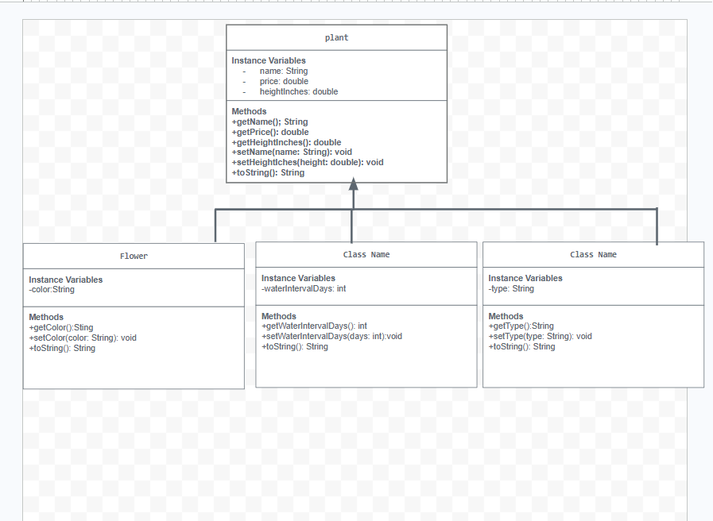

# Lesson-13a-Store-Management-Project
# Unit 2 - Store Management Project

## Introduction

You are opening a new business in your community! Businesses often need programs to manage the products and services they offer and track orders and requests from customers. Your goal is to create a store management system for your business.

## Requirements

Use your knowledge of object-oriented programming and class structure and design to create your store management system:
- **Create a class hierarchy** – Develop a superclass that represents a product or service your business offers and one or more subclasses that extend the superclass to represent more specific types of products or services.
- **Declare instance variables** – Declare instance variables in the superclass that are shared with the subclasses and instance variables in the subclasses that are not shared with the superclass.
- **Write constructors** – Write no-argument and parameterized constructors in the superclass and subclasses. Subclass constructors use the super keyword to call the superclass constructor.
- **Implement accessor and mutator methods** – Write accessor and mutator methods for instance variables that should be accessible and/or modifiable from outside of the class.
- **Implement a toString() method** – Write toString() methods in the superclass and subclasses that return information about the state of an object.

## UML Diagram

Embed your UML Diagram here. Upload the image of your UML Diagram to your repo, then use Markdown to insert your image here:

## Description

1. Write a description of your project here. Include what your store you made, and why you chose this topic. In your description, include as many vocab words from our class to explain how you represented the item/service from your store. If you have user input, explain how the user will interact with your store such as which questions are prompted to the user, what response is your program expecting, and how that is used to output information for your store in the console.

I built a plant store because I thought it would be a fun topic, using a Plant superclass and three subclasses Flower, Succulent, and Tree. I linked them together by inheritance and encapsulation. I coded private instance variables, constructors, getters and setters. Finally, the program uses a Scanner object in the StoreRunner class to print out the full store inventory straight to the console.

2. How is this project related to STEAM (Science, Technology, Engineering, Art, and Mathematics)? Provide explicit examples from the project and details as possible.

This project connects to science through plant traits, technology using the Java software execution, and engineering through object-oriented inheritance hierarchies.Math by utilizing decimal and int data types to track prices and watering intervals.

3. What SLOs did you demonstrate during completing this project?

The SLOs I demonstrated during completing this project are I built and tested my code using problem solving skills to find the errors and fix it to countiue running my code smoothly. I also demonstrated the understanding of the code I am writing while compeleting the requirments for this project.

